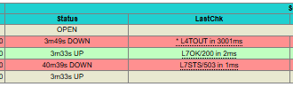
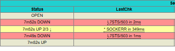
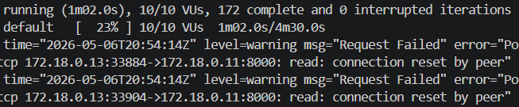
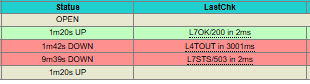
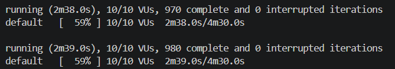
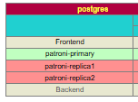

# Сценарий падения узла

1. Запустим все контейнеры `docker compose up -d`.
2. Дождёмся полного запуска с доступом к БД.
3. Откроем `localhost:7000/status` и увидим статусы узлов. Узел `patroni-replica1` оказался в статусе `UP`, два других узла будут со статусами `DOWN`.

4. Убьём узел мастер `docker compose stpo patroni-replica1`
5. На той же странице со статусами увидим задержку по `patroni-replica1` с попытками восстановления.

6. После ~15 секунд попытки восстановления, происходит переключение статуса у `patroni-replica1` на `UP`

7. Запросы к БД доступны вновь и обрабатываются новым узлом

Важное замечание: колонка `status` отвечает только за то, предоставляется ли доступ к этому узлу или нет через `haproxy`. Узнать о доступности узла можно в столбце `LastChk`, который в обычной ситуации будет содержать задержку в `1-2ms`, а в случае упавшего узла (как `primary`) `3001ms`

Таким образом, система показывает свою степень отказоустойчивости.